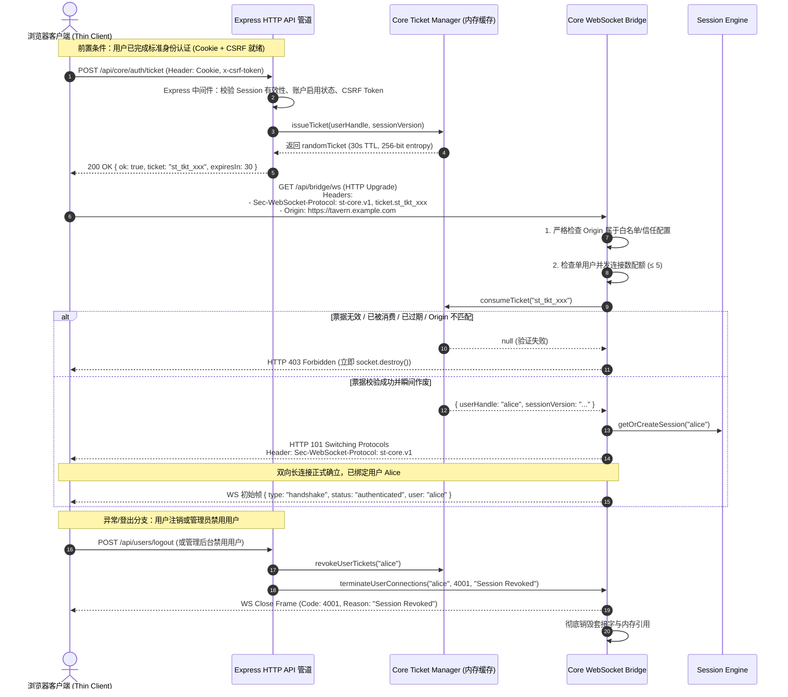
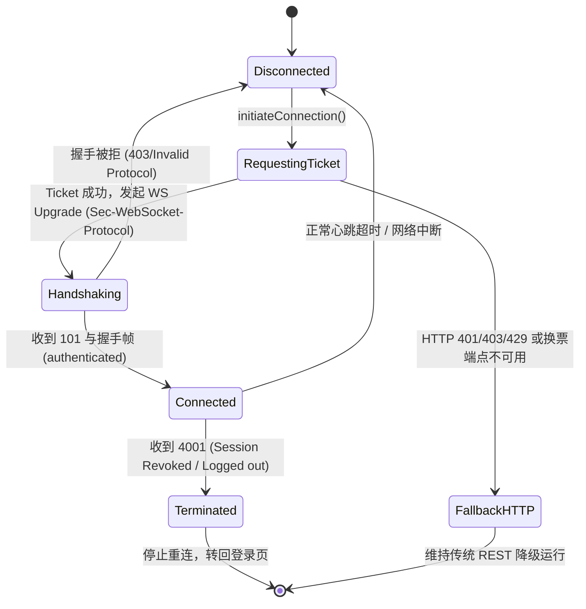
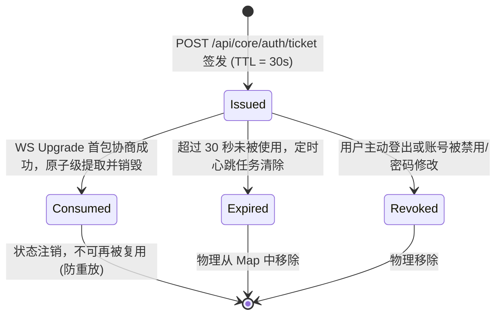

# PROPOSAL-002: SillyTavern 核心双向传输协议安全认证与工单鉴权机制

## 1. 业务背景与安全审查发现

在 PROPOSAL-001 与 ADR-001 中，SillyTavern 提出了“服务端有状态核心化（Server-Side Headless Core）”演进方案，引入 WebSocket Bridge 实现前后端状态镜像同步、Prompt 拦截握手与流式文本推送。

然而，在后续的深度红蓝对抗审查与自动化回归测试（`tests/core-auth-regression.test.js`）中，发现了严重的架构级安全缺陷：
1. **未认证的长连接穿透风险**：原始实现的 `/api/bridge/ws` 挂载于 Node.js 底层 `http.Server.on('upgrade')` 事件，完全绕过了 Express 管道内的全部安全中间件（包括 `cookieSession`、CSRF Token 验证、`whitelist` IP 白名单以及 `requireLoginMiddleware` 用户鉴权）；
2. **跨站长连接劫持 (CSWSH)**：升级阶段未校验 HTTP `Origin` 头部，攻击者可通过恶意钓鱼页面跨域发起 WebSocket 连接；
3. **身份伪造与越权 (Impersonation)**：缺乏可靠的身份绑定，甚至存在直接通过 URL 查询参数（如 `?userId=alice`）伪造会话归属的严重隐患；
4. **长连接生命周期悬挂 (Dangling Connections)**：客户端在浏览器执行 `/api/users/logout` 或管理员在后台禁用账号（`user.enabled = false`）后，已建立的 WebSocket TCP 长连接未被同步断开，导致已失效用户依然能持续接收会话广播与调用 RPC。

针对上述 P0 级风险，提交 `08163b167` 采取了紧急止血措施：**在 `attachServer` 中对所有 `/api/bridge/ws` 请求无条件响应 `HTTP 403 Forbidden` 并切断 Socket，同时禁用生成路由**。

为了使 Headless Core 与双向通信架构真正具备上生产环境的安全资质，必须设计一套**正式、深度防御、符合现代网络安全规范且完全可测试的渐进式认证传输协议（Authenticated Transport Protocol）**。

---

## 2. 目标与非目标 (Goals & Non-Goals)

### 核心目标 (Goals)
1. **全链路认证与单次票据（Ticket-Based Handshake）**：
   - 客户端必须首先通过既有的完整 HTTP 认证管道（携带有效 Session Cookie 与 `x-csrf-token` 请求头），向受保护的 HTTP 端点申请短期临时票据；
   - 票据必须具备单次消费（Single-Use）、超短生存时间（TTL ≤ 30 秒）、高密码学随机熵（256-bit secure random），并在被兑换瞬间立即失效。
2. **零 URL 敏感信息泄露（Sec-WebSocket-Protocol 协议协商）**：
   - **严禁**在 URL 路径或 Query 参数中携带任何 Ticket、Session Token 或 User Handle（防止反向代理日志、浏览器历史、Referer 与抓包日志泄露）；
   - 采用标准 WebSocket 子协议头部 `Sec-WebSocket-Protocol` 传递凭证（格式：`st-core.v1, ticket.<base64url_ticket>`）。
3. **强 Origin 校验与反向代理信任模型**：
   - 在 Upgrade 阶段强行校验 `Origin`。当配置反向代理（如 Nginx、Caddy、Cloudflare）时，结合 Express `trust proxy` 与显式配置的信任域名/IP 清单进行安全核验，彻底阻断跨站 WebSocket 劫持（CSWSH）。
4. **长连接双向撤销与即时阻断（Active Revocation & Termination）**：
   - 用户登出（Logout）、密码修改、管理员禁用用户（Disable）或删除账号时，服务端不仅立即注销 HTTP Session，还必须同步作废该用户所有未使用的 Ticket，并主动强制切断（`ws.close(4001, 'Session Revoked')`）该用户名下所有已连接的 WebSocket。
5. **容量控制与防 DoS 频控（Rate Limiting & Capacity Guard）**：
   - 针对换票端点、WebSocket 握手、单用户并发连接数、全局最大连接数施加内存级限流与容量配额，杜绝恶意耗尽 Node.js 文件描述符。
6. **双模兼容与生态保全**：
   - 完美适配 Single-User（单用户无密码/本地单机）与 Multi-User（多用户隔离、账户系统开启）两种部署模式；
   - 保留 PROPOSAL-001 规定的前端 DOM 插件 `SillyTavern.getContext()` 与生命周期拦截（`CHAT_COMPLETION_PROMPT_READY`）能力，且插件数据交换完全限制在已认证的用户隔离上下文内。
7. **真实进程自动化测试验证**：
   - 提供基于真实 `server.js` 子进程的集成测试用例，覆盖正常握手、票据防重放、过期校验、伪造 Origin 拦截、登出强制断开等完整矩阵。
8. **无缝平滑回滚能力**：
   - 提供配置开关 `core.transport.enabled`，若传输层出现异常，系统可平滑回退至纯 HTTP REST 原生路由，保证系统可用性。

### 明确不做 (Non-Goals)
- **绝不启用当前未认证的原型代码**：绝不通过简单的配置开关把原先存在漏洞的裸 WS 原型放行到生产；
- **绝不声称与 HTTP 无状态安全完全等价**：必须清醒认识到 WebSocket 是有状态的 TCP 长连接，与每次请求均独立过 Express 中间件的 HTTP REST 存在本质差异。长连接一旦建立，不会自动经历每帧的 CSRF 拦截，因此必须依靠显式的连接状态机、帧结构校验与事件驱动的会话吊销机制进行补偿防御；
- **不在传输层引入重量级第三方外部鉴权中间件**（如外部 Redis、OAuth2 Provider、Keycloak），维持 SillyTavern 轻量单机/嵌入式 Node.js 架构；
- **不重构前端 UI 渲染框架与 CSS 架构**。

---

## 3. 核心用户故事 (User Stories - 待审批草案)

### Story 1: 正常已登录用户无缝建立安全长连接
- **场景**：用户 Alice 在多用户模式下通过账号密码登录了 SillyTavern，前端页面加载核心模块。
- **行为**：
  1. 前端通过 `POST /api/core/auth/ticket` 发起换票请求，携带 Alice 的 Session Cookie 与 CSRF Token；
  2. 服务端校验通过，生成一个 30 秒有效期的随机票据 `st_tkt_...`，绑定至 Alice；
  3. 前端发起 WebSocket 握手，请求头附带 `Sec-WebSocket-Protocol: st-core.v1, ticket.st_tkt_...`；
  4. 服务端在 Upgrade 阶段完成 Origin 与票据校验，立即销毁该票据，响应 HTTP 101 Switching Protocols，并在子协议中确认 `st-core.v1`；
  5. 连接成功建立并与 Alice 的专属 Session 绑定，前端收到初始化握手帧。
- **价值**：用户无需感知复杂的握手过程，长连接以完全受控、具备强凭证绑定的形式安全运行。

### Story 2: 严格拦截跨域恶意网页劫持 (CSWSH 防护)
- **场景**：用户 Alice 登录了 SillyTavern，随后在同一浏览器中访问了一个恶意第三方网站 `evil-attacker.com`。
- **行为**：
  1. 恶意网站的脚本尝试利用浏览器自动携带 Cookie 的特性，向 `ws://alice-tavern.local/api/bridge/ws` 发起连接请求；
  2. 服务端在 HTTP Upgrade 事件中检测到 `request.headers.origin` 为 `http://evil-attacker.com`，不属于信任源配置；
  3. 服务端立即响应 `HTTP 403 Forbidden` 并调用 `socket.destroy()` 强制切断底层 TCP 连接；
  4. 恶意网页无法窃取任何聊天会话数据，亦无法调用任何 RPC 接口。
- **价值**：彻底消除跨站长连接劫持这一高危漏洞。

### Story 3: 严格拦截 URL 传参探测与身份伪造
- **场景**：攻击者试图在 URL 中附加参数，例如 `ws://tavern/api/bridge/ws?ticket=123&userId=alice`。
- **行为**：
  1. 服务端检测到 URL Query 包含参数或缺少协议头部的有效 Ticket；
  2. 服务端直接拒绝升级，返回 403 错误并记录安全警告；
  3. 即使内部合法逻辑，也严禁从 URL 解析任何凭据或用户身份，从根源上防止反代日志泄露凭据与身份伪造。
- **价值**：消除凭证落地日志与查询参数欺骗攻击。

### Story 4: 用户登出与账号禁用即时终止长连接
- **场景**：
  - 子场景 A：Alice 在浏览器点击“退出登录（Logout）”；
  - 子场景 B：管理员在后台将违规用户 Bob 设置为“禁用（`enabled = false`）”或修改了其密码。
- **行为**：
  1. 服务端处理登出或状态变更，销毁/更新 HTTP Session；
  2. 会话管理系统触发广播通知：`authBridge.revokeUser(handle)`；
  3. 传输层立即从全局连接池中检索该用户的所有存活 WebSocket，主动调用 `ws.close(4001, "Session Revoked")` 并销毁关联的内存 Session 实例；
  4. 该用户所有签发但尚未兑换的 Ticket 被即刻删除。
- **价值**：杜绝“HTTP 已注销、WS 依然在线收发消息”的僵尸会话漏洞。

### Story 5: 票据防重放与超期失效
- **场景**：中间人或恶意脚本捕获了某次合法的 Ticket，试图在短时间内重复使用，或延迟使用。
- **行为**：
  1. 票据在第一次被服务端兑换校验成功的瞬间，立即从服务端内存表中 `delete`；
  2. 若有第二个 WebSocket 尝试使用同一 Ticket 握手，服务端判定 Ticket 不存在，返回 403 拒绝；
  3. 若 Ticket 签发超过 30 秒未被使用，服务端定时清理任务将其清除，后续升级同样返回 403。
- **价值**：保证凭据的单一时效性，重放攻击完全无效。

### Story 6: 频控限流与连接数配额防护 (DoS Guard)
- **场景**：恶意客户端发起高频换票请求，或单用户建立上百个 WebSocket 连接试图耗尽服务端资源。
- **行为**：
  1. `/api/core/auth/ticket` 挂载 `RateLimiterMemory`，限制单个 IP/用户每分钟换票上限（如 10 次/分）；
  2. WebSocket Bridge 限制单用户最大长连接并发数（默认不超过 5 个，例如手机、平板、PC 各一个标签页）；
  3. 超出限制的换票请求直接返回 HTTP 429，超出连接配额的升级请求返回 HTTP 429/403。
- **价值**：防止长连接滥用与拒绝服务攻击。

### Story 7: 单用户模式下的免打扰安全平移
- **场景**：在个人本地桌面运行 SillyTavern（未开启多用户，`enableUserAccounts: false`）。
- **行为**：
  1. 系统运行于 `default` 用户上下文，HTTP 层由 `tryAutoLogin` / 单用户机制自动签发合法默认 Session；
  2. 前端依然按照标准化流程请求 Ticket，服务端签发绑定至 `default` 的有效 Ticket；
  3. 建立长连接时同样经历标准的 Origin 与 Ticket 校验，不降低安全防护基线；
  4. 用户在单用户与多用户模式切换时，传输层架构代码保持高度统一，零逻辑分叉。
- **价值**：单机用户无需输入密码，同时享受与多用户环境完全一致的 CSWSH 和传输安全防护。

### Story 8: 传输异常降级与一键安全回滚
- **场景**：用户部署环境处于严格限制 WebSocket 的企业代理或反向代理（未开启 `proxy_set_header Upgrade`）。
- **行为**：
  1. 前端在握手超时（如 5 秒）或收到 403 时，自动优雅降级为既有的 HTTP REST 端点；
  2. 若运维需要完全关闭 WebSocket Bridge，只需在 `config.yaml` 中设置 `core.transport.enabled: false`，服务端完全关闭 Upgrade 监听，系统 100% 回退至原有传统 HTTP 运行模式。
- **价值**：高可用容灾与极低运维风险。

---

## 4. 系统架构与关键时序设计

### 4.1 认证握手与换票全时序图



---

## 5. 状态机模型设计

### 5.1 客户端连接生命周期状态机



### 5.2 票据生命周期状态机 (Ticket Lifecycle)



---

## 6. 安全与拓扑设计细节

### 6.1 Sec-WebSocket-Protocol 传输契约
- **请求格式**：
  ```http
  GET /api/bridge/ws HTTP/1.1
  Host: tavern.example.com
  Upgrade: websocket
  Connection: Upgrade
  Sec-WebSocket-Key: dGhlIHNhbXBsZSBub25jZQ==
  Sec-WebSocket-Version: 13
  Origin: https://tavern.example.com
  Sec-WebSocket-Protocol: st-core.v1, ticket.ST-TKT-7f8a9b0c-1234-5678-9abc-def012345678
  ```
- **响应格式（成功 101）**：
  ```http
  HTTP/1.1 101 Switching Protocols
  Upgrade: websocket
  Connection: Upgrade
  Sec-WebSocket-Accept: s3pPLMBiTxaQ9kYGzzhZRbK+xOo=
  Sec-WebSocket-Protocol: st-core.v1
  ```
- **优势**：
  1. `Sec-WebSocket-Protocol` 是标准 RFC 6455 头部，所有浏览器环境均原生支持（`new WebSocket(url, ['st-core.v1', `ticket.${ticket}`])`）；
  2. 不经过 URL Path 或 Query，主流反向代理（Nginx、Apache、Traefik）默认不会在访问日志中记录该头部；
  3. 服务端在完成 101 握手时仅回复标准协议名称 `st-core.v1`，丢弃 `ticket.*` 段，规范整洁。

### 6.2 Origin 白名单与反向代理信任
1. **直接暴露场景（直接监听 IP/Port）**：
   - 比较 `request.headers.origin` 与请求的 `Host` / 当前绑定 IP；
   - 若 `Origin` 缺失（非浏览器）或与 `Host` 不一致，且未显式配置跨域允许，则直接予以 403 拒绝。
2. **反向代理场景（Nginx / Caddy / Cloudflare 等）**：
   - 在 `config.yaml` 中引入配置项：
     ```yaml
     core:
       transport:
         enabled: true
         trustedOrigins:
           - "https://tavern.my-domain.com"
           - "http://localhost:8000"
     ```
   - 握手处理逻辑：
     * 若 `trustedOrigins` 包含当前请求 `Origin`，则允许通过；
     * 若未显式配置 `trustedOrigins`，则强制要求 `Origin` 解析后的主机名与经过反代校验的 `Host` 头部完全吻合；
     * 严禁无脑反射 `Origin` 头部。

### 6.3 插件兼容性规范
- **前端扩展（Client Extensions）**：
  - 保留原有的 `eventSource.on('CHAT_COMPLETION_PROMPT_READY', ...)` 事件机制；
  - WebSocket 接收到服务端的 Prompt 拦截通知后，在客户端局部触发原生事件，等待插件处理完成后回传确认；
  - 插件无需做任何代码修改，保持 100% 生态无感兼容。
- **服务端插件（Server Plugins）**：
  - 服务端插件可在 Node.js 端直接监听核心生命周期事件；
  - 所有会话事件均携带明确的 `userId`，插件处理必须严格限定在当前调用的隔离目录中，杜绝跨租户越权。

---

## 7. 真实测试矩阵 (Verification Matrix)

本方案必须在真实子进程测试沙盒（`CoreAuthServerFixture`）中完成全量回归验证，覆盖以下 8 大核心维度：

| 测试用例分类 | 测试场景描述 | 预期断言 | 对应测试状态 |
| :--- | :--- | :--- | :--- |
| **1. 换票安全验证** | 未登录（无 Cookie）请求 `POST /api/core/auth/ticket` | 返回 HTTP 403 Forbidden | 自动化测试 |
| **2. CSRF 守卫** | 已登录但缺失或伪造 `x-csrf-token` 请求换票 | 返回 HTTP 403 Invalid CSRF | 自动化测试 |
| **3. 正常建立连接** | 携带有效 Ticket 通过 `Sec-WebSocket-Protocol` 握手 | 返回 101 Switching Protocols，子协议协商为 `st-core.v1` | 自动化测试 |
| **4. 票据防重放** | 同一 Ticket 连续发起两次 WebSocket Upgrade | 第一次 101 成功；第二次 403 拒绝 | 自动化测试 |
| **5. 票据超期失效** | 生成 Ticket 后等待 31 秒再发起 Upgrade | 返回 HTTP 403 Forbidden | 自动化测试 |
| **6. 阻断 URL 传参** | 尝试使用 `ws://...?ticket=xxx` 或 `?userId=alice` 握手 | 拒绝升级，返回 HTTP 403 | 自动化测试 |
| **7. 伪造 Origin 拦截** | Upgrade 时携带非信任的 `Origin: http://evil.com` | 返回 HTTP 403，底层 socket 立即 destroy | 自动化测试 |
| **8. 登出即时断开** | 活跃连接存在时调用 `/api/users/logout` | 收到 WS 关闭帧（Code 4001），且后续 HTTP 操作 403 | 自动化测试 |

---

## 8. 回滚与容灾策略 (Rollback Strategy)

1. **核心配置开关**：
   在 `config.yaml` 中定义核心控制字段：
   ```yaml
   core:
     transport:
       enabled: false              # 默认处于稳妥关闭状态，待完全验收后开启
       ticketTtlSeconds: 30        # 票据有效期 (秒)
       maxConnectionsPerUser: 5    # 单用户最大并发连接数
       trustedOrigins: []          # 允许的外部信任域
   ```
2. **快速回滚 SOP**：
   - 若线上发现任何长连接内存泄露、反代握手故障或兼容性问题，运维或用户只需将 `core.transport.enabled` 设为 `false`；
   - 服务端启动时若检测到该值为 `false`，则不注册任何 `/api/bridge/ws` 升级监听，所有核心请求平滑走既有安全的原生 HTTP 管道，实现零停机、无残留的回退。
